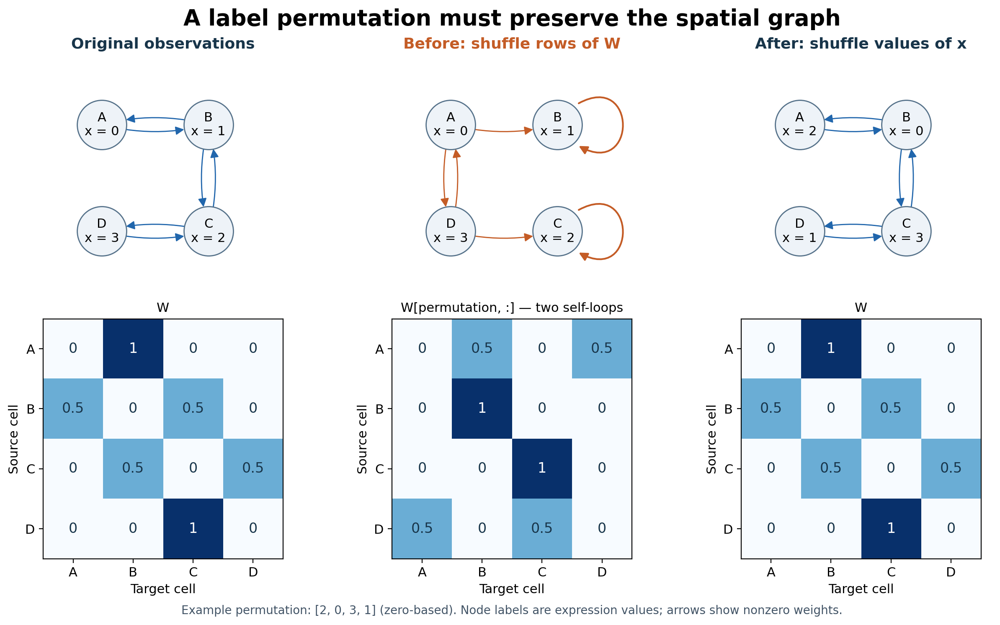
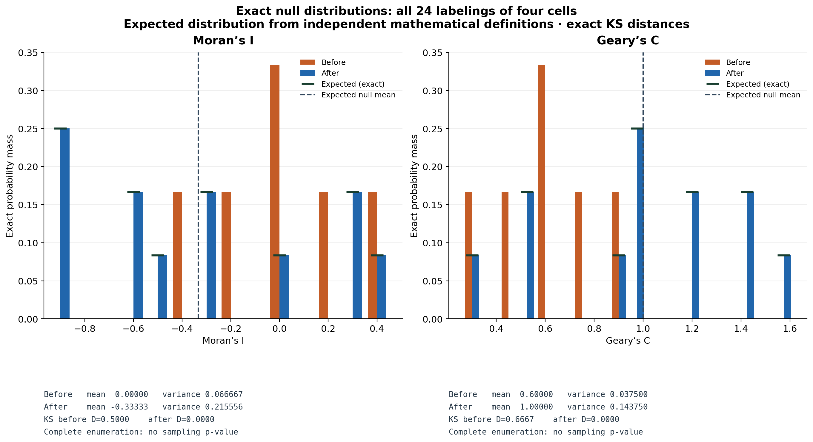
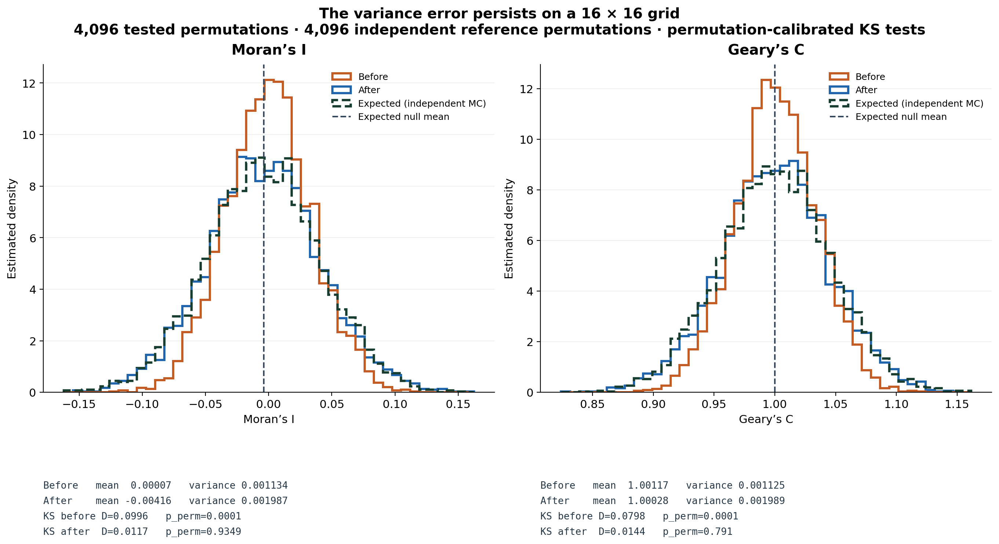

**PR report: correct the permutation null for spatial autocorrelation**

Branch: `fix/spatial-autocorr-permutation-null`. Implementation commit: `602f5b7`.

`spatial_autocorr` previously shuffled only the rows of its spatial weights matrix when generating null scores. This changes which cells are connected and can introduce self-connections. It does not implement random assignment of expression values to fixed spatial locations. The fix shuffles the observation columns of the expression matrix while keeping the spatial graph fixed, for both Moran’s I and Geary’s C.

This follows the observation-permutation scheme in PySAL’s reference implementations of [Moran’s I](https://raw.githubusercontent.com/pysal/esda/main/esda/moran.py) and [Geary’s C](https://raw.githubusercontent.com/pysal/esda/main/esda/geary.py).

```diff
- score_perms[i, :] = func(g[idx_shuffle, :], vals)
+ score_perms[i, :] = func(g, vals[:, idx_shuffle])
```

Here, `vals` has shape `(n_features, n_observations)`. Each permutation applies the same column order to every feature. The existing independent random generator for each permutation is retained.

**1. What changes in a single permutation**

The original observations lie on the path A–B–C–D. The graph has row-normalized weights, and expression is `[0, 1, 2, 3]`. For the example order `[2, 0, 3, 1]`, the previous algorithm creates self-connections at B and C. The corrected algorithm keeps the original path and assigns expression `[2, 0, 3, 1]` to its locations.



*The lower panels show the actual weights matrices. Rows and columns retain the same cell order in every panel. The diagram is a single example; the following comparison includes every possible labeling.*

**2. Exact comparison on the regression-test graph**

We enumerate all `4! = 24` label permutations for the same path and expression feature. This is an exact finite distribution, with no Monte Carlo sampling error. Each permutation is equally likely. The corrected scores are checked against independent implementations of the statistical definitions.

The dark green markers overlay the **expected full distribution**, computed from those independent definitions. The chart also shows each implementation’s Kolmogorov–Smirnov (KS) distance from this reference: `D = sup_t |F_implementation(t) − F_expected(t)|`.

For a graph with zero diagonal, the label-permutation expectations are `E[I] = −1/(n−1)` and `E[C] = 1`. With four observations, these are `−1/3` and `1`. The corrected distributions recover both expectations; the previous distributions do not.



| Statistic | Expected mean | Before: mean | After: mean | Before: variance | After: variance |
| --- | ---: | ---: | ---: | ---: | ---: |
| Moran’s I | −0.333333 | 0.000000 | −0.333333 | 0.066667 | 0.215556 |
| Geary’s C | 1.000000 | 0.600000 | 1.000000 | 0.037500 | 0.143750 |

| Statistic | Before: KS D | After: KS D |
| --- | ---: | ---: |
| Moran’s I | 0.500000 | 0.000000 |
| Geary’s C | 0.666667 | 0.000000 |

*Variances use the full enumerated distribution, with `ddof=0`. Bars for the two algorithms are slightly offset to make overlapping masses visible. The green markers match the corrected masses. These are complete populations rather than independent random samples, so the KS distances are descriptive and have no sampling p-value. [All 24 score triples, including the expected values](exact-null-scores.csv), are included.*

**3. A larger graph also shows a variance error**

The second example uses 256 cells on a 16 × 16 grid, with connections to horizontal and vertical neighbors, no self-connections, and row-normalized weights. One synthetic standard-normal expression feature is held fixed. Both algorithms receive the same 4,096 random label permutations. Expression and permutation generators are spawned independently from seed `42`.

The dashed green **expected distribution** is computed from the statistical definitions using a separate set of 4,096 permutations drawn with seed `43`. It is an independent Monte Carlo reference for the same fixed graph and expression feature; it is not constructed from the corrected algorithm’s tested sample.



| Statistic | Before: variance | After: variance | Before / after |
| --- | ---: | ---: | ---: |
| Moran’s I | 0.001134 | 0.001987 | 57.04% |
| Geary’s C | 0.001125 | 0.001989 | 56.55% |

In this example, the old null distribution has about 43% less variance. The corrected mean is approximately `−0.004160` for Moran’s I, compared with the theoretical `−1/255 ≈ −0.003922`, and `1.000279` for Geary’s C, compared with `1`. Unlike the four-cell enumeration, these histograms are Monte Carlo estimates. Their precise values are specific to this graph, expression feature, and sample of permutations.

| Statistic | Implementation | KS D versus expected | Permutation-calibrated p |
| --- | --- | ---: | ---: |
| Moran’s I | Before | 0.099609 | 0.0001 |
| Moran’s I | After | 0.011719 | 0.9349 |
| Geary’s C | Before | 0.079834 | 0.0001 |
| Geary’s C | After | 0.014404 | 0.7910 |

**How the KS tests are calibrated.** Each test compares one implementation’s score sample with the independent reference sample. The null hypothesis is equality of their score distributions. We compute the two-sided KS distance and calibrate its upper tail using 9,999 pooled-label resamples with generators spawned from seed `44`. The resampling retains ties. P-values use the plus-one correction, so `0.0001` is the simulation’s minimum resolution, not an assertion that the true p-value equals that boundary. The tests use [SciPy’s permutation-test framework](https://docs.scipy.org/doc/scipy/reference/generated/scipy.stats.permutation_test.html), because the usual [continuous-distribution KS p-value](https://docs.scipy.org/doc/scipy/reference/generated/scipy.stats.ks_2samp.html) is not calibrated for discrete tied scores. Scores are rounded to 12 decimal places for the KS calculation to identify mathematical ties despite floating-point evaluation differences.

These KS p-values compare **null-score generators**, not the significance of observed spatial expression. A large p-value is compatibility evidence in this example, not proof of equivalence; pointwise agreement with the mathematical definitions is checked separately. The figures are not a general calibration study of every reported p-value. [All 4,096 score triples](grid-null-scores.csv) and [unrounded statistics, KS results, seeds, and dependency versions](summary.json) are included. In the grid CSV, the expected column uses independent reference permutations, so a shared row number does not indicate a shared label order with the before/after columns.

**Effect on users**

Correcting the permutation scores changes `var_sim`, `pval_sim`, `pval_z_sim`, and corresponding adjusted p-values when correction is enabled. Results from a fixed seed can therefore differ from earlier versions. The original observed I/C statistics and analytic normality calculations are unaffected by this change. The function documentation records the correction for version 1.8.5.

**Validation**

- The new regression test enumerates every labeling of the four-cell path for both statistics, checking every score against its independent mathematical definition and checking the exact null mean. It covers dense, CSR, and CSC expression matrices and verifies that the graph is unchanged.
- All six new regression cases failed against the previous implementation and pass with the fix.
- The relevant test files passed all 44 tests, including serial/parallel reproducibility and seed handling. Ruff lint, formatting, and the whitespace check passed for the implementation and tests.
- The figure-generation script checks every corrected score, including all 4,096 grid permutations for both statistics, against an independent calculation over the original graph’s edges.
- Every reported KS distance is also checked against SciPy’s KS statistic. Additional small examples verified exact permutation p-values of `1/3` for `[0,0]` versus `[1,1]`, `1/10` for `[0,0]` versus `[1,1,1]`, and `1` for identical samples, including ties and unequal sample sizes.

The recorded test command was:

```bash
NUMBA_NUM_THREADS=2 python -m pytest \
  tests/graph/test_ppatterns.py tests/graph/test_utils.py -q --tb=short
```

**Reproduce or reuse the figures**

From the repository root, with this checkout installed in the active Python environment:

```bash
NUMBA_NUM_THREADS=1 python reports/spatial-autocorr-permutation-null/generate_figures.py
```

The [generator](generate_figures.py) runs the corrected `_score_helper` from the installed checkout and evaluates the removed row-shuffling expression as the baseline. It writes PNG figures for the PR, editable SVG figures, before/after/expected score CSVs, and `summary.json`, including the permutation-calibrated KS results. The weights and synthetic data are constructed locally; no external datasets are downloaded.

SVG downloads: [permutation mechanism](01-permutation-mechanism.svg), [exact distributions](02-exact-null-distributions.svg), [grid distributions](03-grid-null-distributions.svg).
